<p align="center">
  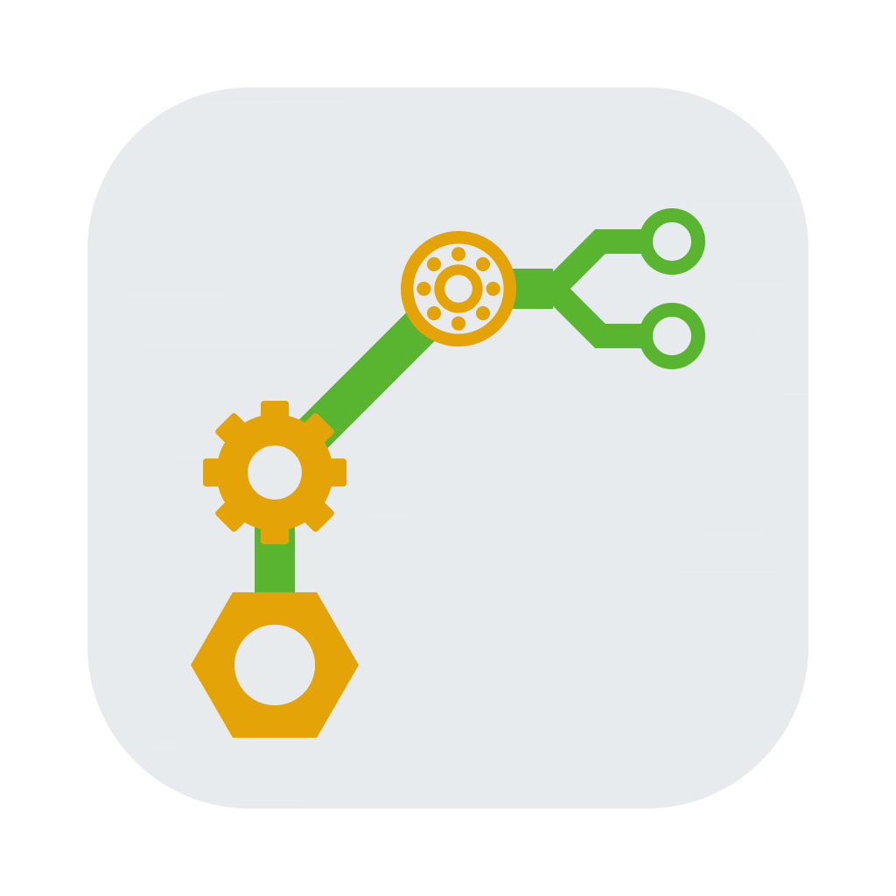
</p>

<h1 align="center">FTC Event Scout</h1>

<p align="center">
  A native macOS app that turns FIRST Tech Challenge event data into sortable OPR rankings, score highlights, and match-level scouting views.
</p>

<p align="center">
  <a href="https://github.com/Sakzyo/FTC_Event_Scout/releases/latest/download/FTC-Event-Scout-1.0.6.dmg"></a>
</p>

<p align="center">
  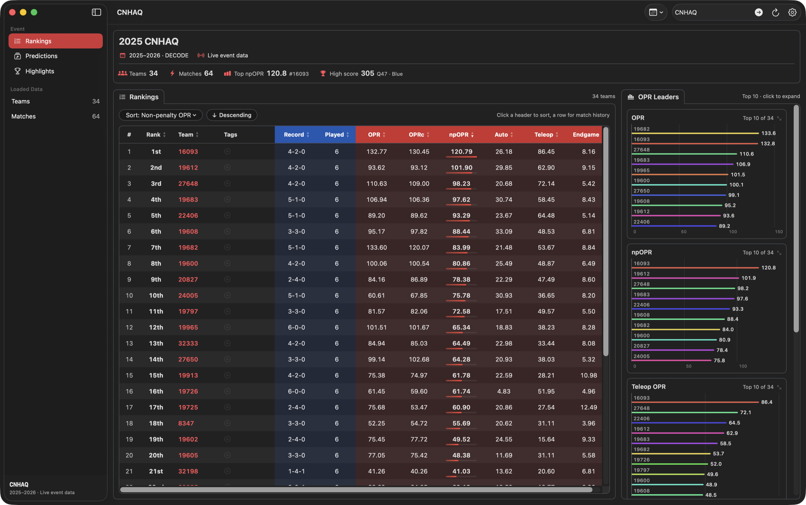
</p>

<p align="center">
  <sub>Live rankings, scouting tags, and color-coded OPR comparisons for every team at an event.</sub>
</p>

**FTC Event Scout** is a native **macOS scouting app** for exploring FIRST Tech Challenge events. It combines live rankings, comparative OPR charts, score highlights, team match history, detailed score breakdowns, and locally stored scouting tags in a SwiftUI interface.


## Features

- **Live event rankings.** Choose an FTC season, enter an event code, and load every registered team and scored match from FIRST Events.
- **Event header card.** A compact card shows the season, game, and data mode, followed by inline stats: team and match counts, the top npOPR team, and the high score for live events, or rookies and the top and average season OPR for previews.
- **FTCScout-style rankings table.** Color-grouped columns (blue for record, matches played, and team history; red for OPR metrics) sit under a pinned header with zebra rows. Click any header to sort by official rank, team number, qualification W-L-T record, matches played, total OPR, calculated OPRc, non-penalty OPR (npOPR), Auto, Teleop, or Endgame OPR; click it again to reverse. The sorted column draws a scale bar under each value, sized against the column leader (records by win rate). Columns stretch to fill wide windows and scroll horizontally in narrow ones.
- **Interactive OPR charts.** Compare OPR, npOPR, Teleop, Auto, and Endgame beside the rankings table, either as stacked top-10 cards for every metric or as one metric at a time with a leader readout and the full field. Switch layouts in **Settings → General → Rankings**. Every metric is ordered from highest at the top to lowest at the bottom.
- **OPRc match predictions.** Recalculate a residual-filtered offensive-power estimate from completed matches, then compare expected alliance scores, winner, signed margin, and data quality for every upcoming match or a custom four-team matchup.
- **Full-event chart drill-down.** Click any compact graph to open a scrollable chart containing every team with an available value. Each team has a distinct color that remains consistent across metrics.
- **Team match history.** Click a team's row to inspect every event appearance, alliance partners, opponents, final and non-penalty scores, and the selected team's win/loss result, with an event W-L-T record and the winning alliance called out on every match.
- **Detailed score breakdowns.** Expand a match to compare red and blue alliance scoring by season-specific Auto, Teleop, Endgame, and penalty categories, from SKYSTONE through BIOBUZZ. The higher value in each numeric row is emphasized so swings are easy to spot.
- **Event highlights.** Surface the highest final, non-penalty, Auto, and Teleop alliance scores, including ties and the teams responsible.
- **Local scouting tags.** Add reusable, color-coded notes to teams and see them in rankings, highlights, and match history. Tags stay on the Mac.
- **Manual match entry.** Create a manual event, type match results on your Mac or import a CSV, and get the same rankings, OPR charts, predictions, highlights, and match history. Manual events work offline, with no FIRST Events credentials or Python.
- **Pre-event previews.** If an event has not started, use FTCScout data to compare the registered teams' OPR from the event's own season.
- **Signed in-app updates.** Open **Settings → Updates** or **FTC Event Scout → Check for Updates…** to download, verify, install, and relaunch through Sparkle 2. Optional automatic checks and installation on quit are available in Settings.


## Feature tour

The screenshots below use the 2025–2026 DECODE event CNHAQ, a 2026–2027 BIOBUZZ pre-event preview, and a BIOBUZZ manual practice event.

### Rankings and OPR leaders

The Rankings view keeps the sortable team table and the OPR Leaders panel side by side. The event header above them shows the season, game, and data mode, then team and match counts, the top npOPR team, and the event's high score.

Click a table header (or use the **Sort** menu) to rank teams by official rank, team number, record, matches played, OPR, OPRc, npOPR, Auto, Teleop, or Endgame; click it again to reverse the order. The sorted column draws a scale bar under each value, sized against the column leader. Blue columns hold record and match counts, red columns hold OPR metrics, and every team keeps the same chart color across all five metrics.

By default the OPR Leaders panel stacks a top-10 chart for every metric, as in the screenshot at the top of this page. Choose **Single Metric** under **Settings → General → Rankings** for one larger chart instead: a segmented OPR / npOPR / Tele / Auto / End switcher, the leader with the field average, and a bar for every team.

<p align="center">
  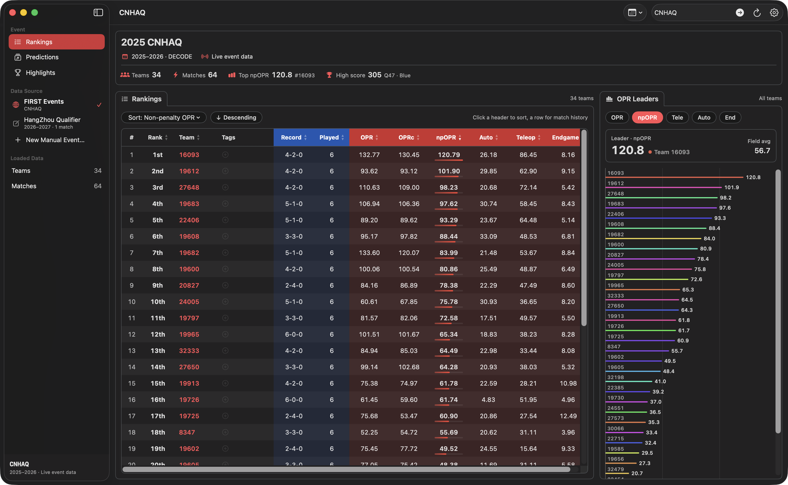
</p>

<p align="center">
  <sub>Single Metric layout: one metric at a time, with the leader, the field average, and the full field.</sub>
</p>

### Full-event chart

Click any compact chart to open it full size. The expanded chart lists every team with a value, from highest at the top to lowest at the bottom, with exact values and negative-value handling.

<p align="center">
  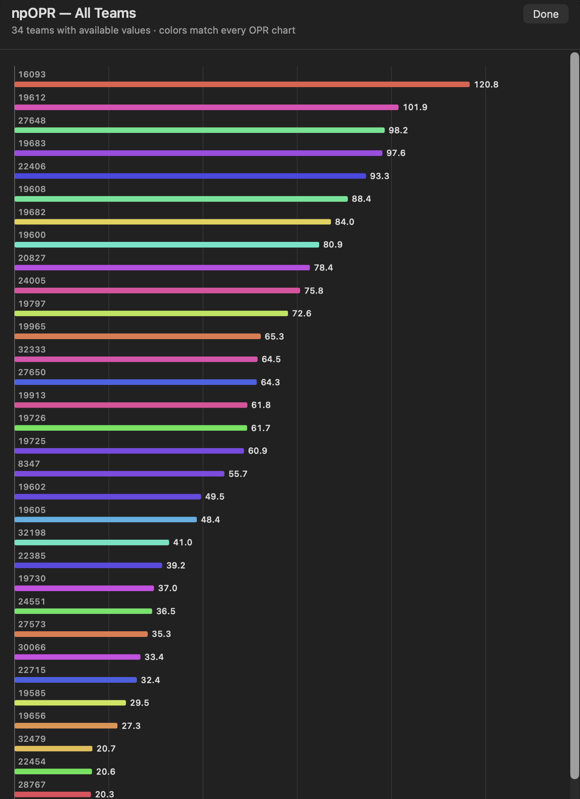
</p>

### Team match history

Click a team's row to open its match history. The top of the sheet shows the team's OPR, OPRc, matches used, and outliers removed, with the residual IQR details one click away. Below it, every match the team played lists both alliances, their final and non-penalty scores, the winner, and whether the selected team (marked with a crosshair) won or lost. The event W-L-T record is in the section header.

<p align="center">
  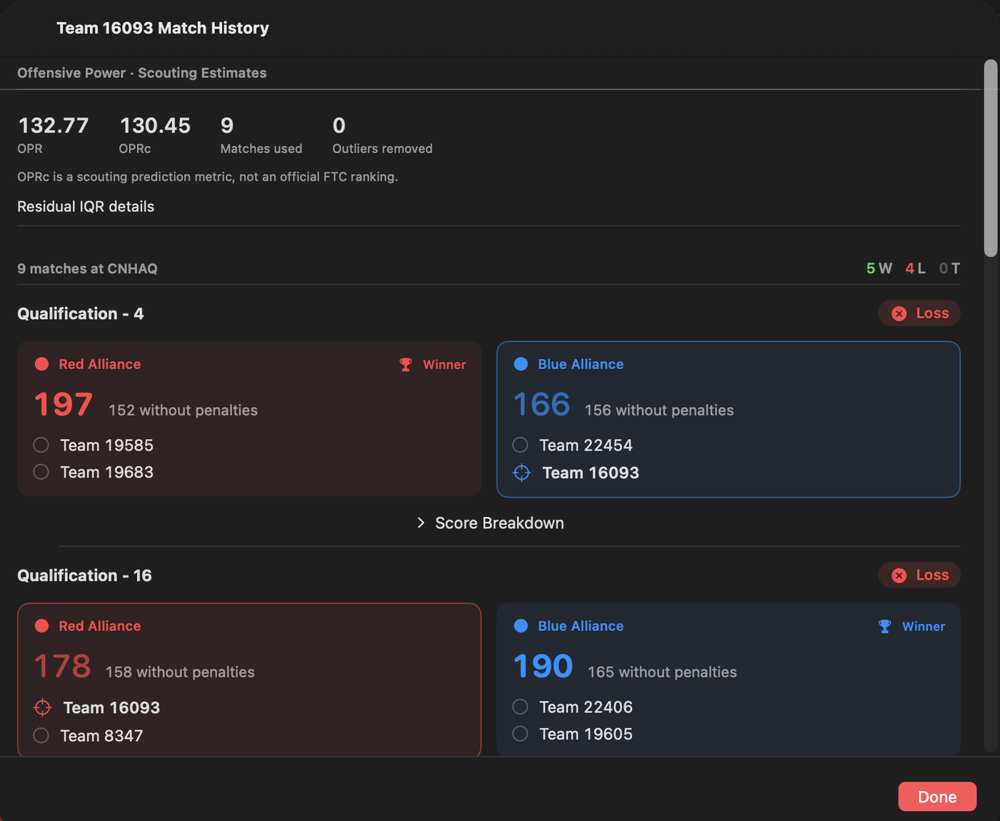
</p>

### Score breakdowns

Expand **Score Breakdown** under a match to compare Red and Blue by the season's own scoring categories, grouped into Auto, Teleop, Endgame, and penalties. The sheet reads head to head: Red and Blue values sit on either side of a center line, and on numeric rows a bar grows toward each alliance, so the winner of every category is clear at a glance. DECODE classifier states appear as purple and green artifacts in groups of three, zeros are dimmed, and subtotals and the final score are ruled off like a paper score sheet. Breakdowns cover every season from SKYSTONE through BIOBUZZ.

<p align="center">
  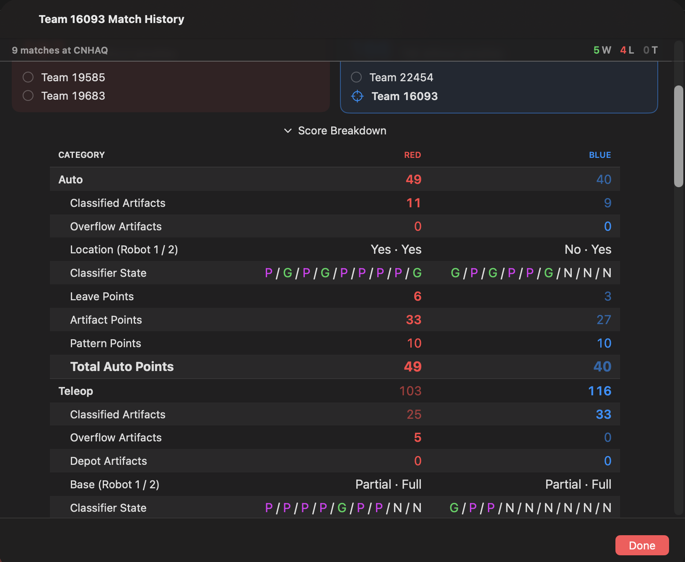
</p>

### Scouting tags

Click the tag button in a team's row to record traits such as `Strong Auto`, `Consistent`, or `Watch Defense`. Each tag has a color. Tags already used at the event appear under **Reuse an Event Tag**, so one click applies the same tag to another team. Tags show in the Rankings table, Highlights, and match history, and they are stored only on your Mac.

<p align="center">
  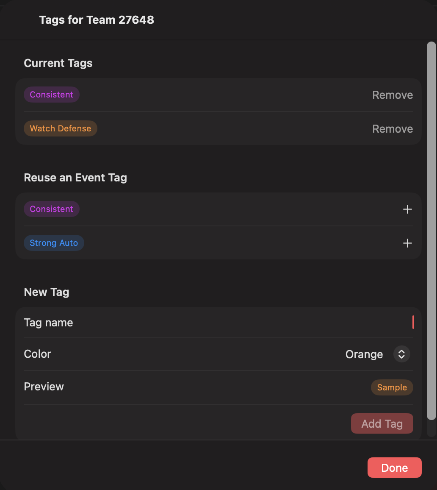
</p>

### Highlights

**Highlights** in the sidebar surfaces the event's highest final, non-penalty, Auto, and Teleop alliance scores. Each card names the match, the alliance, and its teams with their tags, and calls out ties.

<p align="center">
  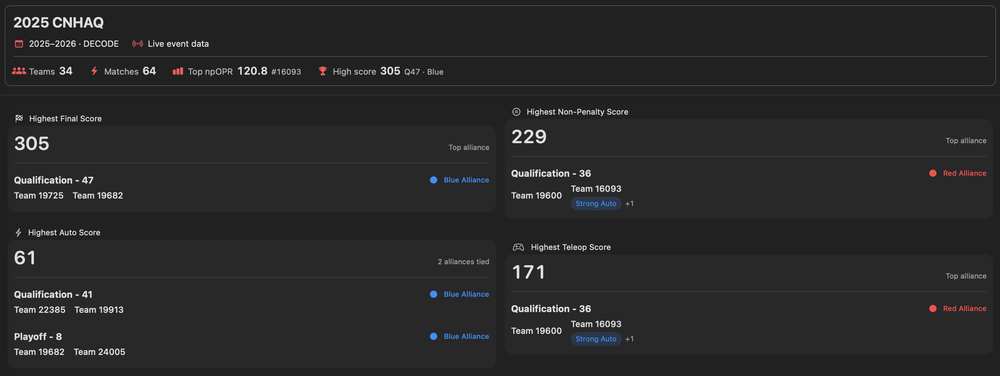
</p>

### Match predictions

**Predictions** forecasts every unplayed match on the schedule from OPRc, a residual-filtered OPR (see [OPRc match predictions](#oprc-match-predictions) below for the method). Each forecast shows both alliances' team OPRc values, the predicted scores, the favored alliance, the signed margin, and a data-quality status.

<p align="center">
  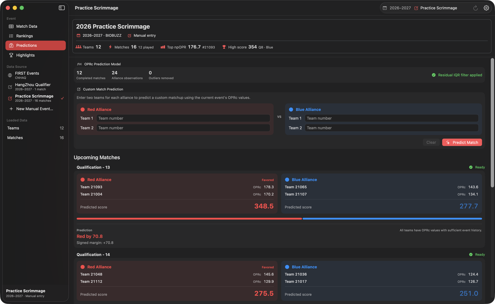
</p>

<p align="center">
  <sub>Scheduled matches are forecast as soon as completed matches give every team an OPRc.</sub>
</p>

You can also enter any two Red and two Blue team numbers under **Custom Match Prediction** to forecast a hypothetical matchup, such as a possible playoff alliance.

<p align="center">
  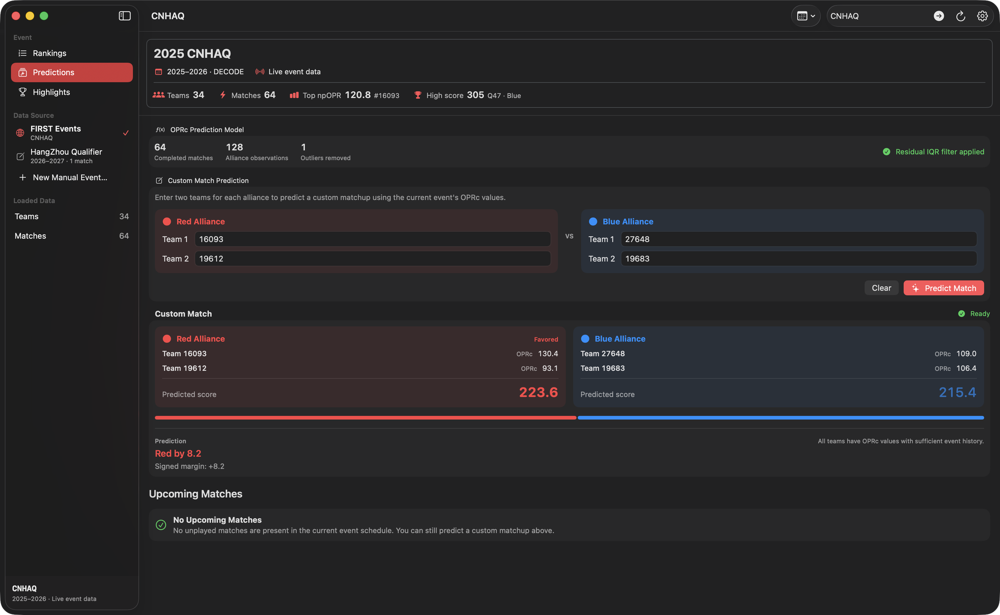
</p>

### Pre-event previews

When an event has no matches yet, loading its code shows a pre-event preview. The table lists each registered team's OPR on FTCScout from the event's season, along with its rookie year; teams that have not played yet that season show no OPR. The header counts teams and rookies and shows the top and average season OPR.

<p align="center">
  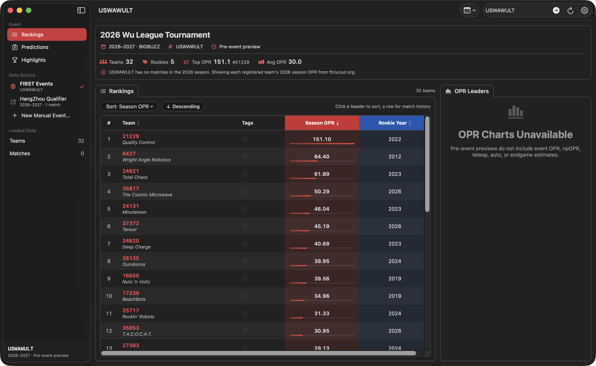
</p>

### Settings and in-app updates

**Settings → General** controls whether the last event code is remembered, picks the OPR Leaders layout, and clears cached event data. **FIRST API** stores your FIRST Events username and token. **Updates** shows the installed version and checks for, downloads, and verifies new releases through Sparkle 2, with optional automatic checks and installation on quit.

<p align="center">
  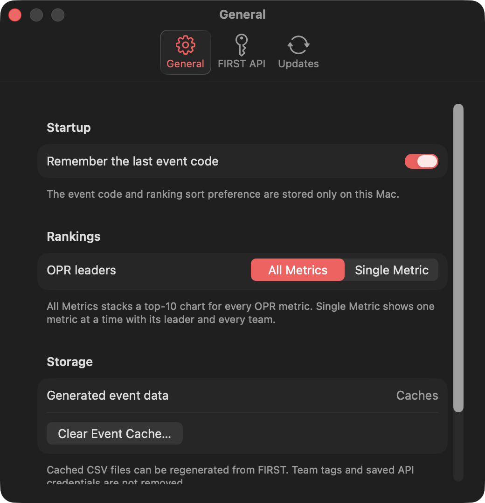
  &nbsp;
  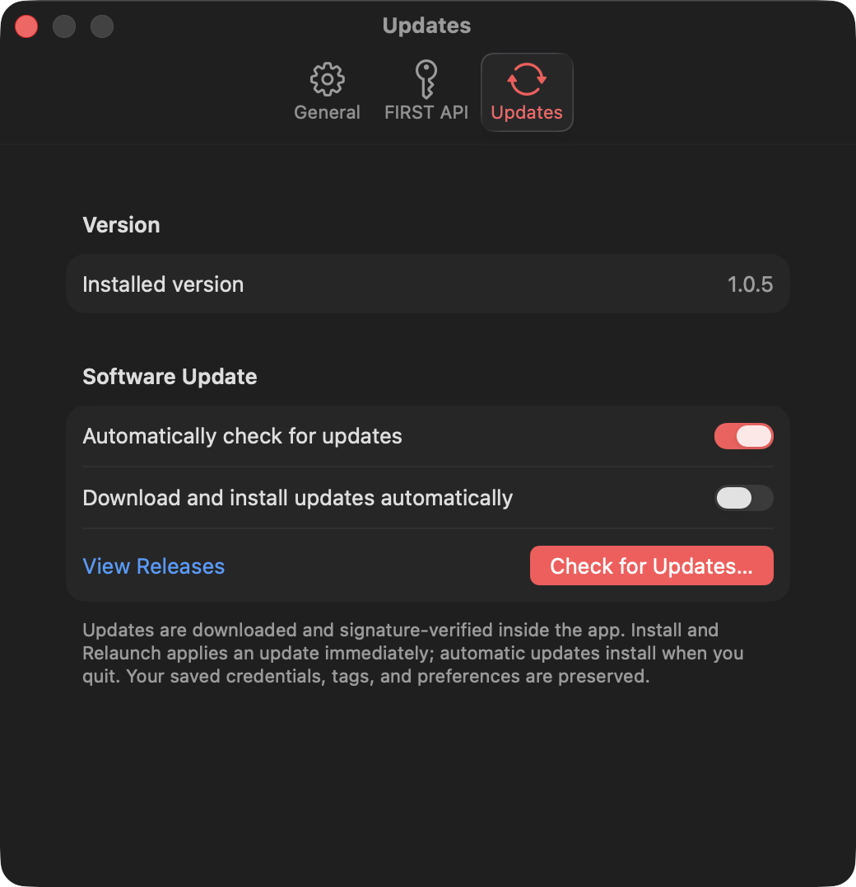
</p>

### A typical scouting workflow

1. Select the season in the toolbar and enter the FIRST event code.
2. Sort the Rankings table by the metric that matters to your scouting question.
3. Compare the compact charts, or click one to see the whole field.
4. Click a team's row to open its match history, then expand **Score Breakdown** for alliance-level detail.
5. Tag teams with traits like `Strong Auto` or `Watch Defense`, and reuse the same tags across the event.
6. Open **Highlights** to find the matches behind the event's best scores, and **Predictions** to forecast upcoming matches or possible alliances.


## Manual match entry

Use manual events for scrimmages, practice days, or any event whose results are not on FIRST Events yet. Choose **Scout → New Manual Event…** (⇧⌘N), **New Manual Event…** in the sidebar, or **Enter Match Data Manually** on the credentials screen. Pick a name and season; the event is saved in the app's private data on this Mac and survives **Clear cached event data**.

The **Match Data** page lists every match beside an editor for the selected one. Enter the four team numbers, then turn on **Scored** to record the result. Unscored matches act as the schedule, so the Predictions page forecasts them with OPRc. **Next Match** (⌘↩) moves on, adding a match when you reach the end.

<p align="center">
  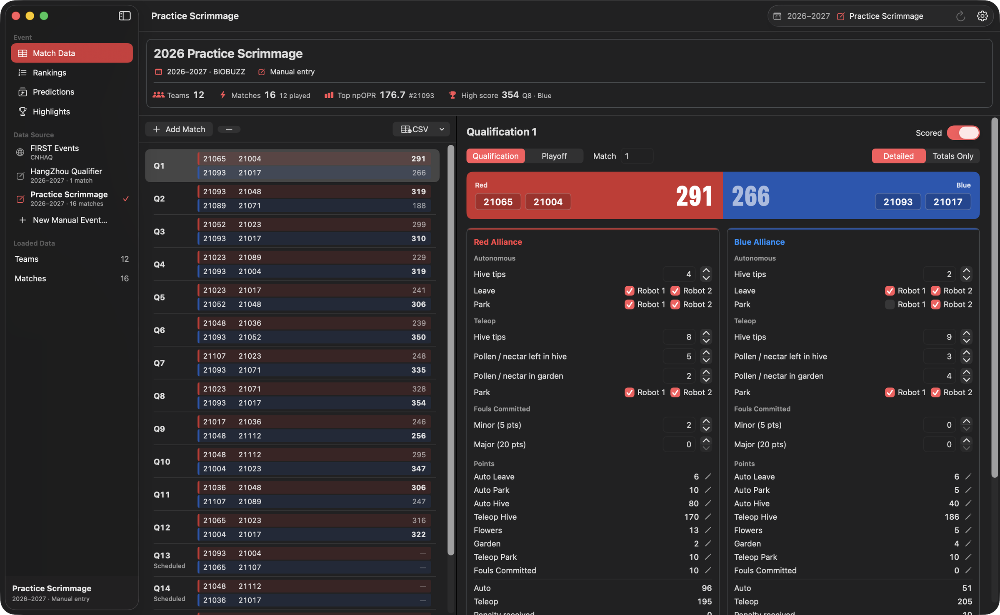
</p>

<p align="center">
  <sub>BIOBUZZ matches are entered as field events; every subtotal and the final score are calculated for you.</sub>
</p>

- **BIOBUZZ** matches record what happened: hive tips, robot leave and park, pollen and nectar left in the hive and garden, each flower's contents from bottom to top, and minor and major fouls. The app calculates every subtotal, the final score, and the Swarm and Pollinator ranking points from the Competition Manual's point values. Any calculated subtotal can be overridden with the pencil button. Choose **Totals Only** for a match when you only know period scores.
- **Other seasons** record Auto, Driver-Controlled (without endgame), Endgame, and penalty points received; the final score is their sum unless you override it.

Rankings use the same least-squares OPR as FIRST Events data, calculated in Swift: total from final scores, npOPR without penalty points received, Auto, Teleop without endgame, and Endgame.

**CSV import and export.** The **CSV** menu imports matches (added to the event, or replacing every match after a confirmation), exports the event, and exports an empty template with the right columns for its season. Columns are `Level` (`Q` or `P`), `Match`, `Game`, `Red1`, `Red2`, `Blue1`, `Blue2`, `Scored` (`Y`/`N`), then per-alliance score columns such as `Red Auto Hive Tips` or `Blue Penalty Received`. BIOBUZZ flower columns list elements bottom to top, separated by `|`, for example `POLLEN|POLLEN|RED_NECTAR`. Rows that can't be imported are skipped and listed with their line numbers. The `Match Details.csv` files the app generates from FIRST Events also import, as Totals Only matches.

Right-click a manual event in the sidebar to rename, export, or delete it. Select **FIRST Events** in the sidebar, or load an event code, to return to online data.


## Supported seasons

The toolbar season picker covers every FIRST Events season with a dedicated score breakdown. DECODE is the default selection.

| Season    | Game           | Notes |
| --------- | -------------- | ----- |
| 2026–2027 | BIOBUZZ        | Hive, flower, garden, and park rows plus Swarm and Pollinator ranking points. Park points fill the Endgame column, and details the API has not published yet show as `—`. |
| 2025–2026 | DECODE         | |
| 2024–2025 | INTO THE DEEP  | |
| 2023–2024 | CENTERSTAGE    | |
| 2022–2023 | POWERPLAY      | |
| 2021–2022 | FREIGHT FRENZY | |
| 2020–2021 | ULTIMATE GOAL  | |
| 2019–2020 | SKYSTONE       | |

Every season gets the same Auto, Teleop, Endgame, penalty, and final totals for OPR and highlights. When FIRST Events leaves out a teleop total, the helper derives it from the final, Auto, and penalty scores.


## How it works

Choose a season and enter an event code; a loopback-only Python helper fetches FIRST Events data, generates CSVs, and calculates least-squares OPR estimates for total, non-penalty, autonomous, teleop, and endgame performance. The Swift calculation layer also derives OPRc and upcoming-match predictions once whenever refreshed event data is loaded. The app turns those results into sortable tables so scouts can compare teams and inspect individual matches.

The visible application is entirely native SwiftUI, while the Python helper uses only the standard library and listens on `127.0.0.1`. FIRST Events credentials are stored in private app data on the Mac; the unencrypted token file is restricted to the current user. When an event has not started, FTCScout data provides a season OPR preview of its registered teams.


## OPRc match predictions

**OPR (Offensive Power Rating)** estimates each team's offensive contribution by solving the alliance-score equations `A × x ≈ b` with least squares. FTC Event Scout's prediction layer uses a deterministic one-sided Jacobi SVD, which provides a Moore–Penrose least-squares result without directly inverting a matrix and remains defined for rank-deficient schedules.

**OPRc (Offensive Power Rating – Calculated)** is this project's robust OPR variant. FIRST Events supplies alliance-level final scores, not trustworthy individual robot scores, so this repository uses alliance OPR residuals as the outlier observations (`x`):

1. Keep unique matches only when both alliances have finite final scores and valid team lists.
2. Calculate baseline OPR from all valid completed-alliance observations.
3. For each alliance, calculate `residual = actual score − predicted score`.
4. Calculate Q1 and Q3 with R-7 linear interpolation and `IQR = Q3 − Q1`.
5. Remove an alliance observation only when its residual is strictly outside:
   - lower: `x < Q1 − 1.5 × IQR`
   - upper: `x > Q3 + 1.5 × IQR`
6. Recalculate OPR once from the retained observations to produce OPRc. The filter is not iterated.

Values exactly on either boundary remain. At least four valid alliance observations are required before filtering; smaller samples keep all observations and are marked as limited data. Repeated values and an IQR of zero are handled by the same strict boundary rule.

For an upcoming match, each alliance's expected score is the sum of its members' OPRc values. The predicted margin is `red − blue`, so positive favors Red, negative favors Blue, and zero is a tie. A prediction is unavailable when any scheduled team lacks an OPRc; it is marked limited when the sample is small, a team has fewer than two retained appearances, or the schedule matrix is rank deficient. OPRc does not invent win probabilities.

The Predictions view also accepts a custom matchup with two Red and two Blue team numbers. It validates all four entries, rejects duplicate teams, and uses the same cached OPRc values, status rules, and result presentation as scheduled matches.

OPR and OPRc are scouting estimates, not official FTC rankings. Their additive model cannot fully represent alliance interaction, defense, penalties, strategy, robot failures, schedule strength, or other nonlinear match effects. Residual filtering reduces the influence of some abnormal scores but does not make a prediction certain.


## Getting started

### Installation

1. Use macOS 14 or later and make sure Python 3 is installed.
2. Download the [latest release](https://github.com/Sakzyo/FTC_Event_Scout/releases/latest/download/FTC-Event-Scout-1.0.6.dmg).
3. Open the downloaded DMG and drag **FTC Event Scout** into **Applications**.
4. Launch the app and enter your FIRST Events API username and token.

Sparkle-enabled builds offer **FTC Event Scout → Check for Updates…** and **Settings → Updates**. Updates are signed ZIP archives installed inside the app, with an **Install and Relaunch** action. Automatic checks and installation on quit can be enabled in Settings. Version 1.0.5 is the first Sparkle-enabled release, so users of 1.0.4 or earlier need to install it manually once; later versions arrive through the in-app updater.

Version 1.0.6 is ad-hoc signed and not notarized. If macOS blocks the first launch, open **System Settings → Privacy & Security** and choose **Open Anyway**.

### Development

Development requires macOS 14+, Xcode with Swift 5.10+ support, and Python 3. Loading live data also requires FIRST Events API credentials. The only Swift dependency, Sparkle 2.10.0, is pinned in `Package.swift`, and SwiftPM downloads it on the first build.

```sh
git clone https://github.com/Sakzyo/FTC_Event_Scout.git
cd FTC_Event_Scout
./script/build_and_run.sh
```

The script builds the `FTCEventScout` executable target, assembles `dist/FTC Event Scout.app`, ad-hoc signs it, and launches it.

For build-only workflows:

```sh
./script/package_app.sh debug
./script/package_app.sh release
```

To create the release app, compressed first-install DMG, and SHA-256 checksum:

```sh
./script/package_dmg.sh
```

To create a signed in-app update ZIP and appcast from the finalized app:

```sh
./script/package_update.sh
```

See [Software updates](docs/software-updates.md) for Keychain setup, signing, optional notarization, publication, and update verification.

### Tests

The Swift suite covers models, ranking presentation, score import, predictions, manual events (BIOBUZZ scoring against recorded FIRST Events payloads, OPR parity with the Python helper, CSV round trips, and storage), credentials, and the updater. The Python suite covers score-breakdown normalization, the BIOBUZZ export pipeline, and update-packaging validation. Neither needs credentials or network access.

```sh
swift test
```

```sh
python3 -m unittest discover -s tests
```


## Repo layout

```text
FTC_Event_Scout/
├── Package.swift                    ← SwiftPM manifest, Sparkle dependency, app and test targets
├── Sources/FTCEventScout/           ← native macOS application
│   ├── App/                         app entry point, scenes, commands, and lifecycle
│   ├── Models/                      event records, predictions, and observable app state
│   ├── Services/                    backend, API, CSV, credentials, tags, predictions, manual events, updates
│   ├── Support/                     shared formatting helpers
│   ├── Views/                       rankings, highlights, match history, manual entry, settings
│   │   ├── ManualEntry/             manual event sidebar, match editor, CSV import and export
│   │   └── Components/              reusable SwiftUI components
│   └── Resources/                   localized strings and the Treeman logo
├── assets/app-icon/                 app icon SVG sources and rendered PNG sizes
├── script/                          ← build, package, DMG, update, launch, and icon tooling
├── config/sparkle-public-key.txt    Ed25519 public key for verifying updates
├── web_server.py                    loopback JSON service used by the app
├── scrape.py                        FIRST Events client and match CSV export
├── score_breakdown.py               season-specific score detail normalization
├── historical_opr.py                FTCScout pre-event season OPR client
├── calculate_opr_from_csv.py        OPR metric preparation and CSV export
├── opr_calc.py                      standard-library least-squares solver
├── event_results/                   bundled seed match-detail CSVs
├── events_teams_opr/                bundled seed OPR CSVs
├── tests/
│   ├── FTCEventScoutTests/          Swift unit tests
│   ├── fixtures/                    recorded FIRST Events score payloads
│   └── test_*.py                    Python score and packaging tests
└── docs/
    ├── software-updates.md          release signing and Sparkle publishing guide
    └── assets/                      current feature captures
```
